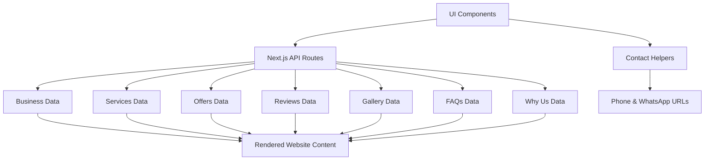

# Aaira Khan Salon & Studio

A modern, responsive website for Aaira Khan Salon & Studio, Karachi, designed to showcase salon services, promotional offers, gallery work, customer testimonials, FAQs, location details, and direct booking options through a polished and accessible interface.

**Live Website:** [https://aaira-khan-salon.vercel.app/](https://aaira-khan-salon.vercel.app/)

## Table of Contents

- [Overview](#overview)
- [Preview and Live Demo](#preview-and-live-demo)
- [Features](#features)
- [Key Implementation Highlights](#key-implementation-highlights)
- [Tech Stack](#tech-stack)
- [Architecture](#architecture)
- [Project Structure](#project-structure)
- [Data Architecture](#data-architecture)
- [SEO](#seo)
- [Design Philosophy & UI/UX](#design-philosophy--uiux)
- [Responsive Experience](#responsive-experience)
- [Contact & Booking](#contact--booking)
- [Getting Started](#getting-started)
- [Deployment](#deployment)
- [Author](#author)

## Overview

Aaira Khan Salon & Studio is a salon website built to bring essential business information and customer-facing actions into one experience.

The website focuses on helping visitors discover services, explore the salon's work, learn about available offers, find location information, and contact the business for appointments.

**Customer journey:**

Discover → Explore Services → View Work → Read Reviews → Find Location → Book

## Preview and Live Demo

Visit the live website:

[**Open Aaira Khan Salon & Studio**](https://aaira-khan-salon.vercel.app/)

### Desktop Preview

[](https://aaira-khan-salon.vercel.app/)

### Responsive Views

- [Tablet Preview](https://raw.githubusercontent.com/hadiashah01/aaira-khan-salon/master/public/images/aaira-khan-salon-tab.png)
- [Mobile Preview](https://raw.githubusercontent.com/hadiashah01/aaira-khan-salon/master/public/images/aaira-khan-salon-mob.png)

> Ensure the screenshot files exist at these paths in the repository. Update the paths if your filenames or directory structure differ.

## Features

### User Experience

- Responsive layouts for desktop, tablet, and mobile.
- Sticky navigation with section-based navigation.
- Mobile navigation menu.
- Mobile booking bar.
- Hero section with direct booking actions.
- Promotional offers and salon service catalog.
- Responsive image gallery.
- Customer testimonials.
- FAQ accordion.
- Why Choose Us section.
- Google Maps location section.
- Responsive typography and spacing.

### Contact & Booking

- Direct WhatsApp inquiries.
- Phone contact actions.
- Contextual WhatsApp messages for service inquiries.
- Google Maps directions.
- Social media profile links.

### Code Organization

- Reusable React components.
- Centralized business information.
- Separate content data modules.
- Shared phone and WhatsApp URL helpers.
- Dedicated Next.js API routes for business content.
- Centralized design tokens.
- Reusable brand and social media icons.

### SEO & Metadata

- Page metadata through the Next.js Metadata API.
- Local business structured data using Schema.org.
- Descriptive image alternative text.
- Search engine crawling directives.
- XML sitemap for public page discovery.
- Canonical URL configuration.
- Social sharing metadata.

> The SEO and metadata features above should remain listed only where they are implemented and configured in the current codebase.

## Key Implementation Highlights

- **Component-based UI:** The interface is divided into reusable components for individual website sections.
- **Centralized business configuration:** Business details are maintained separately from presentation components.
- **Separated content data:** Services, offers, reviews, gallery items, FAQs, and other business content are organized into dedicated modules.
- **Reusable contact helpers:** Phone and WhatsApp URLs are generated through shared utility functions.
- **Dedicated API routes:** Business content is exposed through Next.js API endpoints.
- **Responsive interaction patterns:** Navigation and booking actions adapt to different screen sizes.
- **Search metadata:** Page metadata and local business structured data support a clearer representation of the website.

## Tech Stack

| Technology | Purpose |
|---|---|
| Next.js | Application framework and routing |
| React | Component-based user interface |
| JavaScript | Application logic |
| Tailwind CSS | Styling and responsive layouts |
| next/font | Font loading and optimization |
| Material Symbols | Interface icons |
| Schema.org JSON-LD | Structured business information |
| Google Maps | Business location and directions |
| WhatsApp | Direct customer inquiries |
| Git & GitHub | Version control and source management |
| Vercel | Website deployment |

## Architecture

The application separates presentation components, shared utilities, API routes, and content data.



The diagram represents the intended separation between UI, content access, and shared utilities. The actual request flow depends on how each component consumes the API routes.

## Project Structure

```text
app/
├── api/
│   ├── business/
│   ├── faqs/
│   ├── gallery/
│   ├── offers/
│   ├── reviews/
│   ├── services/
│   └── why-us/
├── components/
│   ├── home/
│   │   ├── FAQ.jsx
│   │   ├── FinalCTA.jsx
│   │   ├── Footer.jsx
│   │   ├── Gallery.jsx
│   │   ├── HeroSection.jsx
│   │   ├── HeroVideo.jsx
│   │   ├── LocationMap.jsx
│   │   ├── MobileBookingBar.jsx
│   │   ├── Navbar.jsx
│   │   ├── ServicesMenu.jsx
│   │   ├── SocialMediaStrip.jsx
│   │   ├── SpecialOffers.jsx
│   │   ├── Testimonials.jsx
│   │   └── WhyChooseUs.jsx
│   └── ui/
│       ├── FacebookIcon.jsx
│       ├── InstagramIcon.jsx
│       ├── TikTokIcon.jsx
│       ├── WhatsAppIcon.jsx
│       └── YoutubeIcon.jsx
├── data/
│   ├── business.js
│   ├── faqs.js
│   ├── gallery.js
│   ├── offers.js
│   ├── reviews.js
│   ├── services.js
│   └── why-us.js
├── lib/
│   └── contact.js
├── favicon.ico
├── globals.css
├── layout.js
├── page.js
├── robots.js
└── sitemap.js
```

*This structure highlights the main application files. Other configuration files and public assets are omitted for readability.*

## Data Architecture

The application organizes business information and customer-facing content into separate modules to improve maintainability and consistency.

### Centralized Business Configuration

Business information is maintained in:

`app/data/business.js`

Depending on the current configuration, this module contains information such as:

- Business name.
- Address and location label.
- Phone and WhatsApp numbers.
- Booking message.
- Opening hours.
- Google Maps information.
- Coordinates.
- Social media profiles.

Contact URL generation is handled separately through:

`app/lib/contact.js`

This keeps reusable phone and WhatsApp URL logic separate from the UI components.

### Content Data

Customer-facing content is organized into dedicated files inside `app/data/`:

- `business.js`
- `services.js`
- `offers.js`
- `reviews.js`
- `gallery.js`
- `faqs.js`
- `why-us.js`

### API Layer

The application provides dedicated Next.js API routes for:

- `/api/business`
- `/api/services`
- `/api/offers`
- `/api/reviews`
- `/api/gallery`
- `/api/faqs`
- `/api/why-us`

These routes expose the relevant content to the application. If the routes return data from local JavaScript modules, the content is locally maintained rather than stored in a database.

### Data Flow

The intended content flow is:

**Content Data → API Routes → UI Components → Rendered Sections**

Shared contact helpers handle phone and WhatsApp actions separately.

## SEO

The website uses Next.js metadata capabilities and structured business information to support search engine discovery and improve how the business is represented online.

SEO-related implementation includes, where configured:

- Descriptive page titles and metadata.
- Open Graph metadata for social sharing.
- Descriptive image alternative text.
- `BeautySalon` structured data using JSON-LD.
- Robots directives for search engine crawling.
- XML sitemap for public page discovery.
- Canonical URL configuration.
- Business address and location information.
- Telephone information and opening hours.

The structured business information can use the centralized business configuration to help keep business details consistent across the application.
 
## Design Philosophy & UI/UX

The interface follows a warm, editorial luxury direction designed to complement salon and bridal beauty services.

Key design principles include:

- A warm, neutral color palette with restrained accent colors.
- Editorial typography combining Montserrat and Oranienbaum.
- Consistent design tokens for colors, typography, spacing, and surfaces.
- Clear visual hierarchy across headings, service information, and calls to action.
- Responsive layouts for desktop, tablet, and mobile.
- Touch-friendly controls and visible interaction states.
- Reusable UI elements for consistent presentation.
- Descriptive image alternative text where applicable.

The goal is to create a refined visual experience while keeping service discovery, location information, and appointment inquiries easy to access.

## Responsive Experience

The interface adapts to different screen sizes through:

- Desktop and mobile navigation patterns.
- Mobile-specific booking actions.
- Flexible service layouts.
- Adaptive gallery grids.
- Responsive typography.
- Touch-friendly controls.
- Flexible spacing and content widths.
- Mobile-first contact actions.

The visual system uses consistent spacing, typography, borders, surfaces, and interaction states throughout the experience.

## Contact & Booking

The website provides customer contact options through:

- WhatsApp inquiries.
- Phone calls.
- Google Maps directions.
- Instagram.
- Facebook.
- YouTube.
- TikTok.

Booking actions use shared contact helpers, while service-specific inquiries can include the selected service in the WhatsApp message.

The website directs visitors to the available contact channels rather than representing a separate appointment-management system.

## Getting Started

### Prerequisites

- Node.js compatible with the project's Next.js version.
- npm.

### Installation

Clone the repository:

```bash
git clone https://github.com/hadiashah01/aaira-khan-salon.git
```

Navigate to the project directory:

```bash
cd aaira-khan-salon
```

Install dependencies:

```bash
npm install
```

### Development

Start the local development server:

```bash
npm run dev
```

Open [http://localhost:3000](http://localhost:3000) in your browser.

### Production Build

Create a production build:

```bash
npm run build
```

### Production Server

After a successful build, start the production server:

```bash
npm start
```

## Deployment

The website is deployed on Vercel.
 

## Author

**Hadia Shahjahan**

- **GitHub:** [hadiashah01](https://github.com/hadiashah01)
- **LinkedIn:** [Hadia Shahjahan](https://www.linkedin.com/in/hadia-shahjahan/)